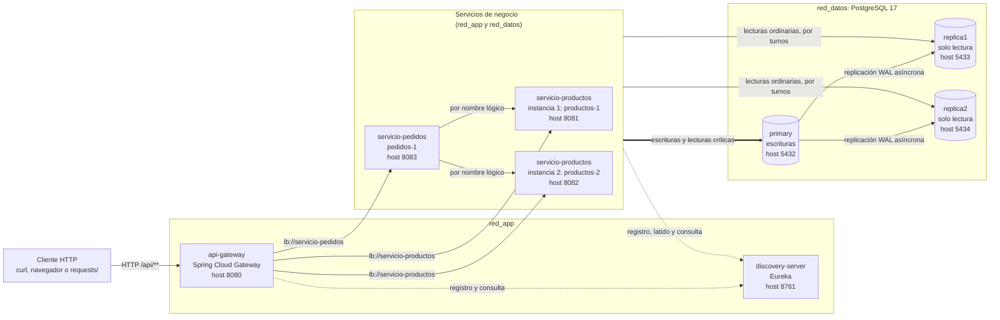

# Microservicios con descubrimiento dinámico, balanceo de carga y persistencia replicada

Proyecto de la asignatura **Aplicaciones Distribuidas** (Universidad Estatal Península de Santa Elena).

Sistema de microservicios en Spring Boot con descubrimiento dinámico (Eureka), un único punto de entrada con balanceo de carga (Spring Cloud Gateway) y una capa PostgreSQL con un nodo primario y dos réplicas de lectura. Todo se levanta con Docker Compose.

> **Estado:** el sistema está completo e integrado. Dos entregables dependen de trabajo que se cierra aparte y están marcados donde corresponde: los resultados de las pruebas P01-P03 en el informe y el enlace del video. Ver [Entregables y documentación](#entregables-y-documentación).

## Equipo

| Integrante | Responsabilidad principal |
|---|---|
| Joseepc18 | Descubrimiento, Gateway e integración con Docker Compose |
| DayronQV | Persistencia replicada y enrutamiento de lecturas y escrituras |
| LuisAnchundia | Microservicios de negocio y comunicación entre servicios |

## Descripción del sistema

El dominio es un catálogo de productos con pedidos:

- **`servicio-productos`** (dos instancias idénticas) administra el catálogo y el inventario.
- **`servicio-pedidos`** registra pedidos. Para crear uno consulta y descuenta stock en `servicio-productos` llamándolo por su nombre lógico de Eureka, sin URLs fijas.
- **`api-gateway`** es el único punto de entrada (`/api/productos/**` y `/api/pedidos/**`). Reparte las solicitudes por turnos entre las instancias registradas en Eureka y reintenta los `GET` ante una instancia caída.
- **`discovery-server`** (Eureka) mantiene el registro de instancias. Sus tiempos están ajustados para que la caída de una instancia se note en segundos.
- **PostgreSQL** corre como un primario y dos réplicas físicas con replicación por WAL. Cada servicio tiene su propia base (`productos_db`, `pedidos_db`) y su propio rol, sin acceso a la base del otro.
- **`persistence-routing`** es una librería compartida: envía las escrituras al primario y reparte las lecturas entre las réplicas sanas. Si una réplica cae, sale de la rotación; si ninguna responde, las lecturas pasan al primario. Las lecturas que deben ver una escritura reciente se declaran críticas y van siempre al primario.

Eureka administra solo a los microservicios. La elección de réplicas PostgreSQL es otra responsabilidad y la resuelve `persistence-routing`.

## Arquitectura



- **Líneas punteadas:** descubrimiento en Eureka. **Líneas gruesas:** escrituras y lecturas críticas, al primario. **Líneas finas hacia las réplicas:** lecturas ordinarias.
- El Gateway y Eureka solo están en `red_app`; PostgreSQL solo en `red_datos`; los servicios de negocio están en ambas redes. El Gateway no puede llegar a la base de datos.
- Los números "host" son los puertos publicados en la máquina del usuario.

Otros diagramas (enrutamiento de persistencia y secuencia de la creación de un pedido) en [docs/diagrama-arquitectura.md](docs/diagrama-arquitectura.md). Decisiones de diseño, tiempos de detección de Eureka, rutas del Gateway y esquema de la base de datos en [docs/arquitectura.md](docs/arquitectura.md).

### Puertos

| Componente | Puerto en el host | Cambiar en `.env` |
|---|---|---|
| Eureka (dashboard) | 8761 | `EUREKA_PORT` |
| Gateway | 8080 | `GATEWAY_PORT` |
| servicio-productos, instancia 1 | 8081 | `PRODUCTOS_1_PORT` |
| servicio-productos, instancia 2 | 8082 | `PRODUCTOS_2_PORT` |
| servicio-pedidos | 8083 | `PEDIDOS_PORT` |
| PostgreSQL primario | 5432 | no (fijo en `docker-compose.yml`) |
| PostgreSQL réplica 1 | 5433 | no (fijo en `docker-compose.yml`) |
| PostgreSQL réplica 2 | 5434 | no (fijo en `docker-compose.yml`) |

Dentro de la red de Compose cada contenedor usa su puerto interno (el mismo número en las aplicaciones y `5432` en los tres nodos de PostgreSQL), así que cambiar un puerto del host no afecta la comunicación entre servicios.

## Estructura del repositorio

```
.
├── database/            Scripts de inicialización del primario y de las réplicas
├── docs/                Arquitectura, diagramas, API, plan de trabajo, informe de pruebas y evidencias
├── requests/            Colección de solicitudes HTTP (.http)
├── scripts/             Scripts de las pruebas P04-P08
├── persistence-routing/ Librería compartida de enrutamiento de lecturas y escrituras
├── discovery-server/    Eureka Server
├── api-gateway/         Spring Cloud Gateway
├── servicio-productos/  Microservicio de catálogo e inventario
├── servicio-pedidos/    Microservicio de pedidos
├── .env.example         Plantilla de configuración (se copia a .env)
├── pom.xml              POM padre (Maven multi-módulo); mvnw y mvnw.cmd: Maven Wrapper
└── docker-compose.yml   Despliegue completo
```

## Requisitos

| Requisito | Para qué | Notas |
|---|---|---|
| Git | Clonar el repositorio | |
| Docker con Compose v2 (`docker compose`) | Construir y ejecutar todo el sistema | En Windows y macOS, Docker Desktop. Se necesita una versión reciente de Compose (se usa `docker compose up --wait`); se desarrolló con Docker 29 y Compose 5 |
| Conexión a Internet | La primera vez | Descarga las imágenes base, Maven y las dependencias. La primera construcción tarda varios minutos |
| Puertos libres: 8080-8083, 8761, 5432-5434 | Publicar los servicios en el host | Los de las aplicaciones se cambian en `.env`; los de PostgreSQL no |
| Bash y `curl` | Solo para los scripts de P04-P08 y los ejemplos con `curl` | En Windows, Git Bash (viene con Git for Windows) |
| Java 21 | Solo para compilar o probar **fuera de Docker** | No hace falta instalar Maven: el repositorio incluye Maven Wrapper (`mvnw`) |

Para levantar el sistema no hace falta Java ni Maven en el equipo: las imágenes se compilan dentro de Docker.

## Dependencias

| Tecnología | Versión |
|---|---|
| Java | 21 |
| Spring Boot | 3.5.16 |
| Spring Cloud | 2025.0.3 (Eureka Server y Client, Gateway, LoadBalancer) |
| Maven (por el Wrapper) | 3.9.16 |
| PostgreSQL | 17 (imagen `postgres:17`) |
| Flyway | Gestionada por Spring Boot (crea el esquema y carga los datos de ejemplo) |
| Imágenes de las aplicaciones | `eclipse-temurin:21-jdk` (compilación) y `eclipse-temurin:21-jre` (ejecución) |

Las versiones están definidas en el [`pom.xml`](pom.xml) de la raíz y en los `Dockerfile` de cada módulo.

## Instalación

```bash
git clone https://github.com/Joseepc18/microservicios-eureka-gateway-pg.git
cd microservicios-eureka-gateway-pg
cp .env.example .env
```

En PowerShell o CMD, el último comando es `copy .env.example .env`. El archivo `.env` no se versiona.

## Configuración

Todo se configura en el archivo `.env`, que se crea a partir de [`.env.example`](.env.example). Hay que reemplazar las cuatro claves de ejemplo; el resto de valores sirven tal cual.

> Las cuatro claves son obligatorias: sin ellas `docker compose` se detiene con un mensaje como `Defina POSTGRES_PASSWORD en el archivo .env`. Use solo letras y números para evitar problemas de interpolación de Compose con caracteres como `$` o `#`.

### PostgreSQL

| Variable | Valor del ejemplo | Qué es |
|---|---|---|
| `POSTGRES_USER` | `admin` | Superusuario de PostgreSQL. Sirve para administrar y para las pruebas manuales; los servicios no lo usan |
| `POSTGRES_PASSWORD` | `cambiar_esta_clave` | Clave de ese superusuario. **Reemplazar** |
| `POSTGRES_DB` | `laboratorio` | Base administrativa inicial |
| `REPLICATION_PASSWORD` | `cambiar_esta_clave_de_replicacion` | Clave del rol `replicator`, con el que las réplicas copian y siguen al primario. **Reemplazar** |

### Credenciales de los servicios

Las bases y los roles tienen nombre fijo y los crea [`database/primary-init.sh`](database/primary-init.sh): `productos_db` con el rol `productos_app` y `pedidos_db` con el rol `pedidos_app`. En `.env` solo se define la clave de cada rol.

| Variable | Valor del ejemplo | Qué es |
|---|---|---|
| `PRODUCTOS_DB_PASSWORD` | `cambiar_clave_productos` | Clave de `productos_app` (la usan las dos instancias de `servicio-productos`). **Reemplazar** |
| `PEDIDOS_DB_PASSWORD` | `cambiar_clave_pedidos` | Clave de `pedidos_app` (la usa `servicio-pedidos`). **Reemplazar** |

> Las claves se aplican solo cuando se crea el volumen del primario. Si se cambian en `.env` después del primer arranque, los roles existentes conservan la clave anterior: hay que recrear el entorno con `docker compose down -v` (borra los datos).

### Puertos publicados en el host

| Variable | Valor del ejemplo | Qué es |
|---|---|---|
| `EUREKA_PORT` | `8761` | Puerto del dashboard de Eureka |
| `GATEWAY_PORT` | `8080` | Puerto del Gateway, el punto de entrada |
| `PRODUCTOS_1_PORT` | `8081` | Acceso directo a la instancia 1 de `servicio-productos` |
| `PRODUCTOS_2_PORT` | `8082` | Acceso directo a la instancia 2 de `servicio-productos` |
| `PEDIDOS_PORT` | `8083` | Acceso directo a `servicio-pedidos` |

Si un puerto del host está ocupado (`ports are not available`), cambie el valor correspondiente (por ejemplo `GATEWAY_PORT=18080`). El puerto interno del contenedor no cambia.

### Identificadores de instancia

| Variable | Valor del ejemplo | Qué es |
|---|---|---|
| `GATEWAY_INSTANCE_ID` | `gateway-1` | Identificador del Gateway en Eureka |
| `PRODUCTOS_1_INSTANCE_ID` | `productos-1` | Identificador de la instancia 1 de productos. Es el valor del header `X-Instance-Id` de sus respuestas |
| `PRODUCTOS_2_INSTANCE_ID` | `productos-2` | Ídem, instancia 2 |
| `PEDIDOS_INSTANCE_ID` | `pedidos-1` | Identificador de `servicio-pedidos` |

El resto de la configuración (rutas del Gateway, tiempos de Eureka, reintentos, `persistence.routing.*`) está en los `application.yml` de cada módulo y en `docker-compose.yml`, y se explica en [docs/arquitectura.md](docs/arquitectura.md) y en el [README de persistence-routing](persistence-routing/README.md).

## Ejecución

> **Windows con Docker Desktop:** en todos los ejemplos se usa `127.0.0.1` y no `localhost`. En algunos equipos `localhost` resuelve primero a IPv6 (`::1`) y la solicitud se queda colgada.

### Iniciar

Desde la raíz del repositorio, con el `.env` ya creado:

```bash
docker compose up -d --build --wait
```

`--wait` devuelve el control cuando todos los contenedores están saludables. El orden de arranque lo controlan los healthchecks: PostgreSQL y Eureka arrancan primero; el Gateway y los servicios de negocio esperan a que estén saludables. Las réplicas esperan al primario y se inicializan solas con una copia base. Son 8 contenedores: `discovery-server`, `api-gateway`, `servicio-productos-1`, `servicio-productos-2`, `servicio-pedidos`, `primary`, `replica1` y `replica2`.

### Verificar

```bash
docker compose ps                                    # los 8 deben figurar como (healthy)
curl http://127.0.0.1:8080/actuator/health           # salud del Gateway: {"status":"UP",...}
curl http://127.0.0.1:8080/actuator/gateway/routes   # rutas lb:// cargadas
curl -H "Accept: application/json" http://127.0.0.1:8761/eureka/apps   # registro de Eureka en JSON
```

En el dashboard de Eureka (http://127.0.0.1:8761) deben aparecer `API-GATEWAY`, `SERVICIO-PEDIDOS` y dos instancias de `SERVICIO-PRODUCTOS`, con instanceId `servicio-productos:productos-1` y `servicio-productos:productos-2`.

### Primeras solicitudes

Todo el tráfico normal pasa por el Gateway (puerto 8080):

```bash
# Catálogo de ejemplo. El header X-Instance-Id indica qué instancia respondió
curl -i http://127.0.0.1:8080/api/productos

# Crear un pedido de 2 unidades del producto 1: responde 201 con el pedido en estado CREADO
curl -i -X POST http://127.0.0.1:8080/api/pedidos \
  -H "Content-Type: application/json" \
  -d '{"productoId":1,"cantidad":2}'

# Consultar y listar pedidos
curl http://127.0.0.1:8080/api/pedidos/1
curl http://127.0.0.1:8080/api/pedidos
```

En PowerShell, use `curl.exe` en lugar de `curl` (el alias `curl` es otro comando). Todas las operaciones, validaciones y códigos de error están en [docs/api.md](docs/api.md).

Para ver el comportamiento del sistema en los logs:

```bash
docker compose logs -f api-gateway                              # GW method=GET ... target=servicio-productos-1:8081 instanceId=productos-1 ...
docker compose logs servicio-pedidos | grep "DB route"         # nodo PostgreSQL usado en cada operación
```

En PowerShell, reemplace `| grep "DB route"` por `| Select-String "DB route"`.

### Detener

```bash
docker compose down        # detiene y elimina los contenedores; conserva los datos de PostgreSQL
docker compose down -v     # además elimina los volúmenes: reinicio desde cero, borra todos los datos
```

## Datos de prueba

No hay que cargar nada a mano.

**Productos.** Al arrancar, Flyway crea la tabla `producto` y carga estos cinco productos ([`V2__datos_de_ejemplo.sql`](servicio-productos/src/main/resources/db/migration/V2__datos_de_ejemplo.sql)). En un entorno recién creado reciben los ids 1 a 5:

| id | nombre | precio | stock |
|---|---|---|---|
| 1 | Laptop 14 pulgadas | 749.90 | 25 |
| 2 | Mouse inalámbrico | 12.50 | 150 |
| 3 | Teclado mecánico | 45.00 | 80 |
| 4 | Monitor 24 pulgadas | 139.99 | 40 |
| 5 | Auriculares | 29.75 | 100 |

**Pedidos.** La tabla `pedido` (la crea [`V1__crear_tabla_pedido.sql`](servicio-pedidos/src/main/resources/db/migration/V1__crear_tabla_pedido.sql)) empieza vacía; los pedidos se crean con `POST /api/pedidos`. Cada pedido descuenta stock del producto.

**Bases de datos.** Para consultar a mano (dentro del contenedor, `psql` no pide clave):

```bash
docker compose exec primary sh -c 'psql -U "$POSTGRES_USER" -d productos_db -c "SELECT * FROM producto;"'
```

Las pruebas P04-P08 crean además productos y pedidos de prueba en cada ejecución.

## Pruebas y compilación

### Compilar y ejecutar las pruebas unitarias

Solo hace falta Java 21. Las pruebas no usan Docker ni PostgreSQL. Desde la raíz del repositorio:

```bash
./mvnw -B clean verify
```

En PowerShell o CMD: `.\mvnw.cmd -B clean verify`. Compila los cinco módulos y ejecuta sus pruebas. La primera vez descarga Maven automáticamente.

Compilar o ejecutar un solo módulo, o construir su imagen (el contexto de build es la raíz):

```bash
./mvnw -pl discovery-server -am package
java -jar discovery-server/target/discovery-server-*.jar
docker build -f discovery-server/Dockerfile -t discovery-server .
```

### Pruebas experimentales P01-P08

Los escenarios, los procedimientos y los resultados están en [docs/informe-pruebas.md](docs/informe-pruebas.md). Las evidencias de P04-P08 (salidas completas y logs) están en [docs/evidencias/](docs/evidencias/).

#### P04 · Comunicación entre servicios

Requiere el sistema completo levantado (`docker compose up -d --build --wait`) y se ejecuta desde la raíz del repositorio con Bash (en Windows, Git Bash):

```bash
scripts/p04-comunicacion.sh    # pedido por el Gateway → servicio-productos; errores 404, 409 y 503
```

Crea pedidos, sigue cada solicitud por su `X-Request-Id` en los logs de ambos servicios y detiene las dos instancias de `servicio-productos` para provocar el `503` (las vuelve a iniciar al terminar, incluso si el script falla). Guarda la salida y las trazas en `docs/evidencias/P04/`. Usa las mismas variables que los scripts de persistencia, más `EUREKA` para la URL de Eureka.

#### P05-P08 · Persistencia

Los scripts de P05-P08 requieren el sistema completo levantado y se ejecutan desde la raíz del repositorio con Bash (en Windows, Git Bash). Cada uno provoca su escenario, imprime el resultado (`PXX OK` o `PXX FALLA`) y guarda su salida y el log de enrutamiento de `servicio-pedidos` en `docs/evidencias/PXX/`. Ejecutarlos en este orden:

```bash
scripts/p05-enrutamiento.sh    # escrituras al primario, lecturas alternadas entre réplicas
scripts/p06-fallo-replica.sh   # detiene replica1: las lecturas siguen por replica2 (la deja detenida)
scripts/p07-consistencia.sh    # crear y consultar al instante con la lectura crítica (primario)
scripts/p08-recuperacion.sh    # reinicia replica1: se pone al día y vuelve a la rotación
```

Usan `curl`, `docker compose` y el `.env` de la raíz. Si las variables están en otro archivo, se indica con `ENV_FILE=/ruta/al/archivo`. Si el Gateway no está en el puerto 8080, se indica con `GATEWAY_PORT`. P07 pausa unos segundos el replay de WAL de las réplicas para mostrar el retraso y lo reanuda siempre al terminar. Los scripts sobrescriben las evidencias de su carpeta.

## Recuperación de componentes

### Una instancia de servicio

Sirve igual para cualquier servicio de Compose (`servicio-productos-1`, `servicio-productos-2`, `servicio-pedidos`, `api-gateway`). Ejemplo con la instancia 2 de productos:

```bash
docker compose stop servicio-productos-2     # parada ordenada: Eureka la marca DOWN a los ~2 s
docker compose start servicio-productos-2    # vuelve a registrarse sola (~20-30 s)
docker compose ps                            # debe figurar (healthy)
docker compose logs servicio-productos-2     # diagnóstico
docker compose restart servicio-pedidos      # reiniciar un servicio
```

- Con la instancia detenida, el Gateway reparte las solicitudes entre las restantes. Los `GET` que lleguen a la instancia caída se reintentan en otra.
- Con `docker compose stop`, la instancia avisa a Eureka y la marca `DOWN` a los ~2 s, y el Gateway deja de enviarle tráfico en pocos segundos. Eureka no la retira del registro de inmediato: sigue apareciendo hasta los ~25 s.
- Si la instancia cae de forma abrupta (sin avisar, por ejemplo `docker compose kill servicio-productos-2`), Eureka la expulsa a los ~24-27 s y el Gateway deja de enviarle solicitudes a los ~30 s (hasta ~35 s en el peor caso). Durante esa ventana hay errores `500` transitorios: en P03, entre 8 y 11 de unas 135 solicitudes `GET`, que el reintento del Gateway no siempre rescata, y las escrituras dirigidas a ella pueden fallar. El cliente debe reintentar (ver [docs/arquitectura.md](docs/arquitectura.md#eureka-configuración-y-tiempos-de-detección)).
- Los contenedores no tienen reinicio automático: una instancia caída hay que iniciarla con `docker compose start`.
- Si `servicio-productos` no tiene ninguna instancia registrada, `servicio-pedidos` responde `503` al crear pedidos.

### Una réplica PostgreSQL

Con una réplica detenida las lecturas continúan por la otra: `persistence-routing` la excluye de la rotación y, si no queda ninguna, lee del primario. Para recuperarla:

```bash
docker compose start replica1
docker compose ps                       # replica1 debe figurar (healthy)
docker compose exec primary sh -c 'psql -U "$POSTGRES_USER" -d "$POSTGRES_DB" -c "SELECT application_name, state, sent_lsn, replay_lsn FROM pg_stat_replication;"'
```

`pg_stat_replication` debe mostrar `replica1` y `replica2` en estado `streaming`. La réplica recibe del primario el WAL que se generó mientras estaba detenida (lo conserva su slot de replicación) y el módulo la devuelve a la rotación cuando responde, sigue en recuperación y su retraso es aceptable: unos 12 s tras el arranque en P08. El estado se sigue con `docker compose logs servicio-pedidos | grep "DB health"`. [`scripts/p08-recuperacion.sh`](scripts/p08-recuperacion.sh) automatiza y documenta este procedimiento.

**Réplica irrecuperable.** Si el slot de la réplica se invalidó (`wal_status = lost`, por superar `max_slot_wal_keep_size = 1GB` mientras estaba caída), no puede ponerse al día y hay que reconstruirla. Se borra solo el volumen de esa réplica:

```bash
docker compose exec primary sh -c 'psql -U "$POSTGRES_USER" -d "$POSTGRES_DB" -c "SELECT slot_name, active, wal_status FROM pg_replication_slots;"'
docker compose rm -sf replica1
docker volume ls                        # buscar el volumen de replica1: <proyecto>_replica1_data
docker volume rm <proyecto>_replica1_data
echo "SELECT pg_drop_replication_slot('replica1'); SELECT pg_create_physical_replication_slot('replica1', true);" | docker compose exec -T primary sh -c 'psql -U "$POSTGRES_USER" -d "$POSTGRES_DB"'
docker compose up -d replica1
```

El prefijo `<proyecto>` es el nombre del proyecto de Compose, normalmente el nombre de la carpeta del repositorio.

### El primario PostgreSQL

No hay promoción automática de una réplica (queda fuera del alcance). Con el primario detenido fallan las escrituras y las lecturas críticas. Se recupera con `docker compose start primary` y se comprueba con `docker compose ps` y la consulta de `pg_stat_replication` de arriba.

### Reiniciar desde cero

```bash
docker compose down -v
docker compose up -d --build --wait
```

También es necesario si el entorno se creó antes de este esquema de bases y roles, o si se cambiaron las claves del `.env` después del primer arranque.

## Solución de problemas

| Síntoma | Causa y solución |
|---|---|
| `Defina ... en el archivo .env` | Falta el `.env` o una de las cuatro claves. Ver [Configuración](#configuración) |
| `ports are not available` | Puerto del host ocupado. Cambiarlo en `.env` (los de PostgreSQL, 5432-5434, no se cambian ahí: liberarlos) |
| `curl` se cuelga con `localhost` | Usar `127.0.0.1` (Windows con Docker Desktop) |
| `docker compose up --wait` termina con un contenedor `unhealthy` | `docker compose logs <servicio>`. Si la base se creó con claves anteriores, `docker compose down -v` |
| Un servicio no aparece en Eureka | Esperar ~30 s tras el arranque (registro y consulta cada 5 s) y revisar `docker compose logs <servicio>` |

## Entregables y documentación

| Entregable | Dónde |
|---|---|
| Código y despliegue | Este repositorio; `docker-compose.yml` |
| README técnico y diagrama de arquitectura | Este archivo y [docs/diagrama-arquitectura.md](docs/diagrama-arquitectura.md) |
| Arquitectura y decisiones de diseño | [docs/arquitectura.md](docs/arquitectura.md) |
| API REST | [docs/api.md](docs/api.md) |
| Informe de pruebas P01-P08 | [docs/informe-pruebas.md](docs/informe-pruebas.md) |
| Colección de solicitudes | [requests/](requests/README.md) |
| Video demostrativo | Ver más abajo |
| Librería de persistencia | [persistence-routing/README.md](persistence-routing/README.md) |
| Plan de trabajo | [docs/plan-de-trabajo.md](docs/plan-de-trabajo.md) |
| Material de referencia | [Pruebas de replicación PostgreSQL](docs/referencia/pg-pruebas-replicacion.md) y [Replicación y sincronización en PostgreSQL](docs/referencia/replicacion-y-sincronizacion.md) |

### Informe de pruebas

P04-P08 (comunicación entre servicios y persistencia) están ejecutadas y documentadas, con evidencias en [docs/evidencias/](docs/evidencias/). **Pendiente:** los resultados de P01-P03 (descubrimiento, balanceo y fallo de instancia) se completan en el informe al integrar su PR (issue #5).

### Colección de solicitudes

Ejemplos de todas las operaciones a través del Gateway, con casos de error y verificación del sistema, en [requests/](requests/README.md). Son archivos `.http` que se usan con VS Code (extensión REST Client) o con IntelliJ. La documentación de cada operación está en [docs/api.md](docs/api.md).

### Video demostrativo

**Pendiente:** el enlace público se agrega al cerrar la issue #15. Enlace: _por agregar_.

## Limitaciones conocidas

- Sin failover del primario PostgreSQL ni transacciones distribuidas.
- El Gateway no tiene autenticación y Eureka es un servidor único, sin alta disponibilidad: es un laboratorio, no un despliegue de producción.
- La replicación es asíncrona: una lectura ordinaria puede no ver una escritura reciente (por eso existen las lecturas críticas).
- La retención de WAL por slots puede acumular espacio en el primario mientras una réplica está caída (tope: 1 GB).

El detalle y los casos observados están en [docs/arquitectura.md](docs/arquitectura.md), [docs/api.md](docs/api.md#limitación-sin-transacciones-distribuidas) y la sección *Limitaciones observadas* de [docs/informe-pruebas.md](docs/informe-pruebas.md).

## Colaboración

Ver [CONTRIBUTING.md](CONTRIBUTING.md).
