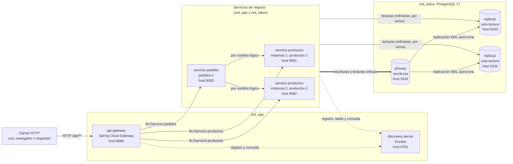
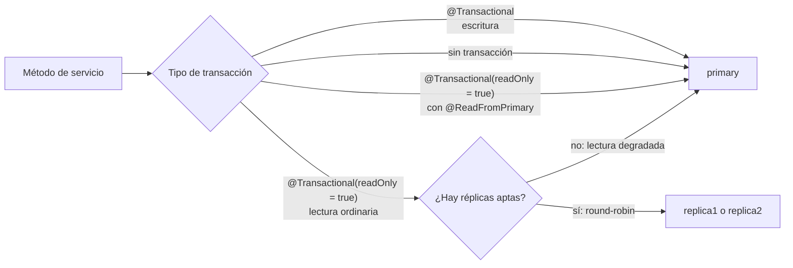
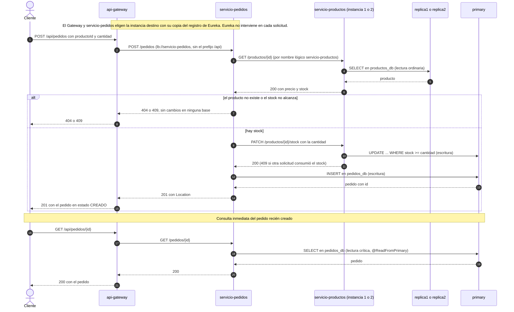

# Diagrama de arquitectura

Los diagramas están en [Mermaid](https://mermaid.js.org/), que GitHub dibuja directamente. Describen lo que levanta `docker-compose.yml`. El texto de cada decisión está en [arquitectura.md](arquitectura.md).

## Componentes, puertos y redes

Cómo leerlo:

- **Líneas punteadas:** descubrimiento. Cada aplicación se registra en Eureka y envía un latido cada 5 s. El Gateway y `servicio-pedidos` copian el registro cada 5 s y eligen la instancia con su copia local, por lo que Eureka no está en el camino de cada solicitud.
- **Líneas gruesas:** escrituras y lecturas críticas, que van al primario.
- **Líneas finas hacia las réplicas:** lecturas ordinarias (`@Transactional(readOnly = true)`), repartidas por turnos entre `replica1` y `replica2`. Si ninguna réplica está apta, el módulo las degrada al primario.
- **Redes:** el Gateway y Eureka solo están en `red_app`; PostgreSQL solo en `red_datos`; los tres servicios de negocio están en las dos. Por eso el Gateway no puede llegar a la base de datos.
- **Puertos:** los números "host" son los publicados en la máquina del usuario (los de las aplicaciones se cambian en `.env`; los de PostgreSQL están fijos en `docker-compose.yml`). Dentro de Compose, cada contenedor usa su puerto interno (el mismo número en las aplicaciones y `5432` en los tres nodos de PostgreSQL).

| Componente | Nombre en Compose | Puerto en el host | Puerto interno |
|---|---|---|---|
| Eureka | `discovery-server` | 8761 (`EUREKA_PORT`) | 8761 |
| Gateway | `api-gateway` | 8080 (`GATEWAY_PORT`) | 8080 |
| servicio-productos, instancia 1 | `servicio-productos-1` | 8081 (`PRODUCTOS_1_PORT`) | 8081 |
| servicio-productos, instancia 2 | `servicio-productos-2` | 8082 (`PRODUCTOS_2_PORT`) | 8082 |
| servicio-pedidos | `servicio-pedidos` | 8083 (`PEDIDOS_PORT`) | 8083 |
| PostgreSQL primario | `primary` | 5432 | 5432 |
| PostgreSQL réplica 1 | `replica1` | 5433 | 5432 |
| PostgreSQL réplica 2 | `replica2` | 5434 | 5432 |

## Enrutamiento de persistencia

Lo decide el módulo [`persistence-routing`](../persistence-routing/README.md) cuando la transacción pide su conexión. Los servicios solo anotan sus métodos.

Una réplica está apta si responde, sigue en modo recuperación (no fue promovida) y su retraso no supera 10 s. El único método con `@ReadFromPrimary` es `GET /pedidos/{id}` de `servicio-pedidos`, porque el cliente lo consulta justo después de crear el pedido.

## Secuencia: crear un pedido

`POST /api/pedidos` es la operación que cruza todos los componentes. Al final, el cliente consulta el pedido recién creado.

Puntos que conviene recordar:

- `servicio-pedidos` no abre una transacción durante las llamadas HTTP: la base de datos solo interviene al guardar el pedido.
- No hay transacciones distribuidas. El stock se descuenta antes de guardar el pedido; si el guardado falla, queda una inconsistencia que se corrige a mano (ver [api.md](api.md#limitación-sin-transacciones-distribuidas)).
- Las llamadas de `servicio-pedidos` a `servicio-productos` no se reintentan (un `PATCH` repetido podría descontar dos veces). Sin instancias disponibles, responde `503`.
- La consulta final va al primario porque una réplica con retraso podría no tener todavía el pedido (comprobado en P07, ver [informe-pruebas.md](informe-pruebas.md)).
